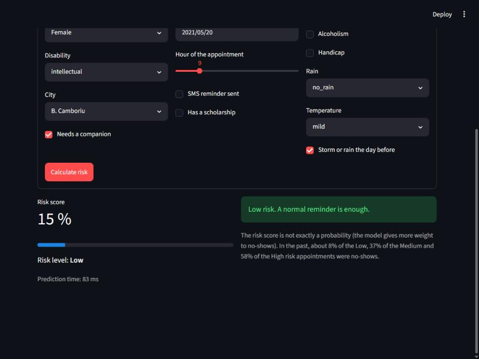

# Medical Appointment No-Show Prediction and Demand Forecasting

A rehabilitation clinic in southern Brazil (CER, University of Vale do Itajai) has about 31.8% no-shows and an unpredictable
number of appointments per day. In this project I built two models and a Streamlit app:

1. **No-show model (classification):** gives every appointment a risk score.
2. **Demand model (forecasting):** predicts the number of appointments per day, for all specialties and for each specialty.
3. **Streamlit app:** a form for the no-show risk, a forecast page and an insights page.

## Files

| File | What it is |
|---|---|
| `Medical_Appointments_Project_Fixed.ipynb` | Final notebook: cleaning, EDA, features, models, results, business impact |
| `Medical_Appointments_Project.ipynb` | My first version of the notebook |
| `app.py` | Streamlit app |
| `Medical_appointment_data.csv` | The data (109,593 rows, 26 columns) |
| `models/` | Saved models: `no_show_model.joblib` and `demand_models.joblib` |
| `reports/` | Result tables (CSV) |
| `charts/` | Charts of the notebook |
| `requirements.txt` | Python packages |

## How to run

```bash
pip install -r requirements.txt
jupyter notebook Medical_Appointments_Project_Fixed.ipynb      # Kernel > Restart and Run All (about 1 to 2 minutes)
streamlit run app.py
```
The saved models are already in the repository, so the app also runs without running the notebook.

## What I did

**Cleaning**
* `no_show` yes/no changed to 1/0.
* Missing `specialty`, `disability` and `place` became a group called `unknown` (I did not delete the rows).
* Only 13 cities are real (written in capital letters); the other 26,000 place names look fake (for example "Lake Michael"), so they became `other place`.
* Missing `age` (21%) was filled with the median and a column `age_missing` was added. Missing weather (2%) was filled with the median.

**Features:** month, day of the week, weekend, health score (number of conditions), 3 interaction features (`weekend_x_hour`, `age_x_health_score`, `child_x_companion`), and 0/1 columns for the text columns (`pd.get_dummies`). I tested the interaction features: they did not improve the model (F1 0.640 without, 0.639 with), but they do no harm.

**No-show model (classification):** 80/20 split (stratified), class weights for the imbalance, 3 models (Logistic Regression, Random Forest, XGBoost). XGBoost is the best. Feature importance and 3 risk groups (Low / Medium / High) are calculated.

**Demand model (regression):** appointments per day + weather; features: calendar, appointments yesterday (`lag_1`), 7 days ago (`lag_7`), the average of the last 7 days and 2 interaction features (weekend x recent demand, which did not help either); chronological split (first 80% of the days for training, last 20% for testing); 3 models (Linear Regression, Random Forest, XGBoost) compared with the simple rule "average of the last 7 days". Random Forest is the best and its feature importance shows that it mostly uses the demand of last week, yesterday and the weather. The same steps are used for every specialty. I also looked at the demand by season (no clear pattern in 16 months of data) and by city (Itajai is about 3 times the next city).

## Results against the project targets

| Model | Metric | Target | Result |
|---|---|---|---|
| No-show (XGBoost) | ROC-AUC | > 0.75 | **0.788 (reached)** |
| No-show (XGBoost) | F1 of the no-show class | > 0.70 | 0.639 (not reached); average F1 of both classes 0.71 |
| No-show (XGBoost) | Precision / Recall | - | 0.52 / 0.82 |
| Forecast (Random Forest) | R2 | > 0.65 | 0.615 (not reached) |
| Forecast (Random Forest) | MAPE | < 20% | 50% on days with 50+ appointments, 619% on all days (not reached) |
| Forecast (Random Forest) | MAE / RMSE | - | 99 / 176 appointments per day |

Why the forecast targets are missed: the number of appointments changes between 1 and 1,500 per day, and some periods have almost no appointments
(for example since 3 April 2021 there are only about 4 per day), so the percentage error is very large on these days. Why the F1 target is missed: all 3 models stop around 0.64.

**Business impact**
* The top 30% risk group has 55% of all the no-shows (no-show rate of the groups: Low 8%, Medium 37%, High 58%).
* If reminders work for 10% / 20% / 30% of the no-shows of that group, the no-shows go down by 5.5% / 11% / 16% (assumed success rates).
* The forecast has 40% less error than the rule "average of the last 7 days" (about 10 specialists per day instead of 17, assuming 10 appointments per specialist).
* Deployment: the models are small (0.8 MB and 25 MB) and a prediction takes milliseconds, so the app can run on a normal computer; the models must be retrained with new data.

## Streamlit app
* **No-show risk:** form with validation (age 0 to 110), risk score, risk level and a suggested action, with a spinner while it calculates (the prediction takes a few milliseconds).
* **Demand forecast:** choose the specialty, the start date and the number of days; chart, table, number of specialists and CSV download.
* **Insights:** model results, top factors, risk groups, the forecast feature importance, the demand by city and the charts of the notebook.



## Data dictionary (short)

| Column | Meaning |
|---|---|
| `no_show` | yes / no (target) |
| `gender`, `age`, `under_12_years_old`, `over_60_years_old` | patient |
| `disability`, `patient_needs_companion` | patient |
| `specialty`, `appointment_time` (hour), `appointment_shift`, `appointment_date_continuous` | appointment |
| `place` | city of the patient |
| `Hipertension`, `Diabetes`, `Alcoholism`, `Handcap` | health conditions (0/1) |
| `Scholarship`, `SMS_received` | social benefit, SMS reminder (0/1) |
| `average_temp_day`, `max_temp_day`, `average_rain_day`, `max_rain_day` | weather of the day |
| `rain_intensity`, `heat_intensity`, `rainy_day_before`, `storm_day_before` | weather groups |

## Limits
* The weather values are the same for the whole day, so they may also work as a "date label" for the model; I cannot say that the weather causes the change in demand.
* The data has periods with almost no appointments, probably not recorded; this makes the forecast difficult.
* The classifier uses a random split, and the success rates of the reminders and the number of appointments per specialist are my assumptions.
* For real future days there is no weather forecast, so the app uses the typical weather of the month.
